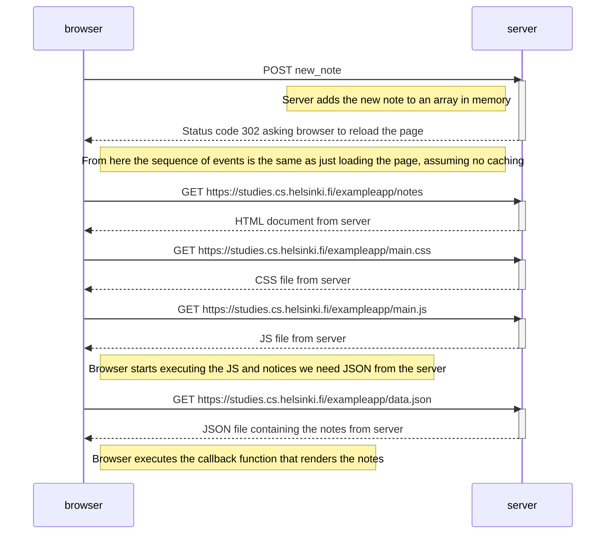

# Sequence diagram of posting a note
## This diagram shows what happens when posting a note on this site:
## <https://studies.cs.helsinki.fi/exampleapp/notes>

There is actually one remaining caveat to this: The CSS and JS files are independent of each other, so really the browser shouldn't have to wait for the CSS file before it can request the JS. The diagram, however, makes it look like GET JS comes strictly after receiving the CSS.

